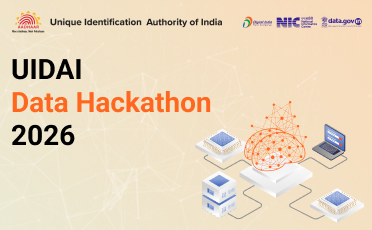
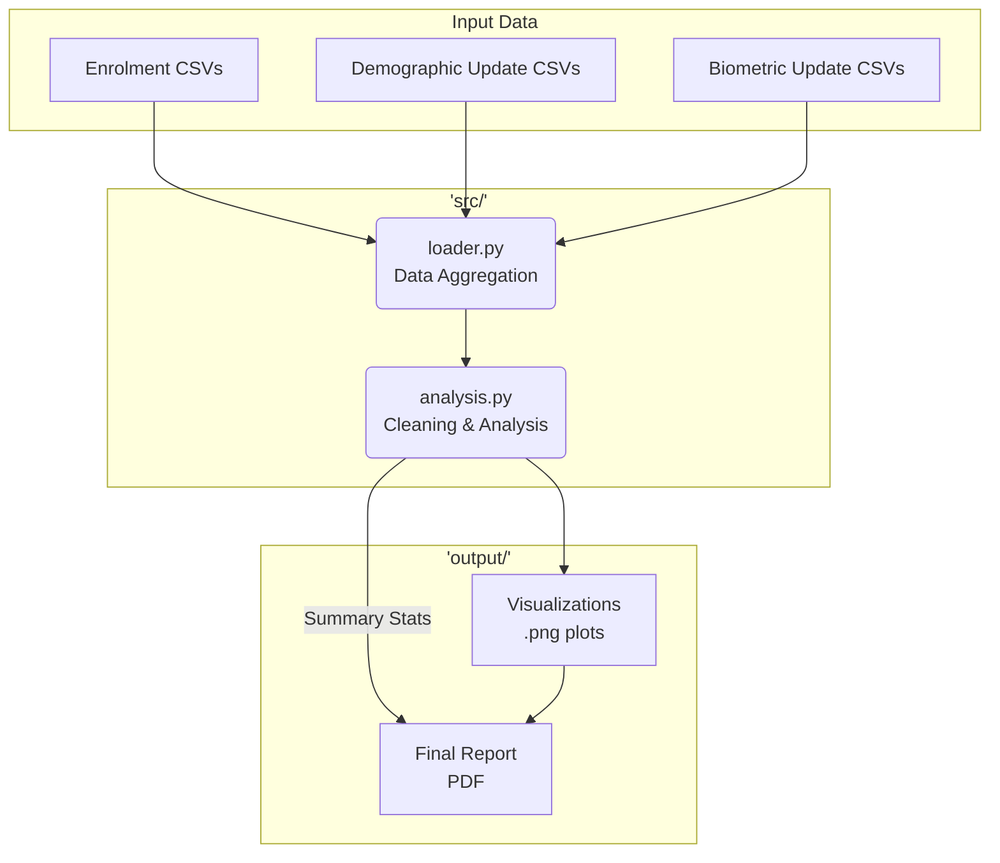

# UIDAI Data Hackathon 2026



This project is a comprehensive data analysis and visualization tool developed for the UIDAI Data Hackathon 2026. It processes Aadhaar enrolment, demographic update, and biometric update data to identify trends, spatial distributions, and correlations.

## 🚀 Features

* **Data Aggregation**: Automatically loads and merges multiple CSV datasets (Enrolment, Demographic, Biometric).
* **Data Preprocessing**: Handles missing values, inconsistent column names, and date formats.
* **Trend Analysis**:
  * **Temporal**: Analyzes trends over time for enrolments and updates.
  * **Spatial**: Identifies top states and districts with the highest activity.
* **Data Aggregation**: Automatically loads and merges multiple CSV datasets (Enrolment, Demographic, Biometric).
* **Data Preprocessing**: Handles missing values, inconsistent column names, and date formats.
* **Trend Analysis**:
  * **Temporal**: Analyzes trends over time for enrolments and updates.
  * **Spatial**: Identifies top states and districts with the highest activity.
  * **Demographic**: examines age group distributions (0-5, 5-17, 18+).
* **Visualization**: Generates high-quality charts:
  * Line plots for time-series analysis.
  * Bar charts for state-wise comparisons.
  * Correlations heatmaps (code available).
* **Report Generation**: Automatically compiles all insights and visualizations into a professional PDF report (`UIDAI_Hackathon_Submission.pdf`).
* **Google Colab Support**: Includes a specialized notebook for running the analysis seamlessly in the cloud.

## 🔄 Data Flow



## 📂 Project Structure

```
UIDAI-HACKATHON/
├── src/
│   ├── analysis.py                  # Core analysis logic and plotting
│   ├── loader.py                    # Data loading and aggregation
│   ├── generate_report.py           # PDF report generation
│   ├── colab_all_in_one.py          # Consolidated script for Colab
│   └── aadhaar_hackathon_colab.ipynb # Jupyter Notebook for Colab (Recommended)
├── output/                          # Generated plots and PDF report
├── requirements.txt                 # Python dependencies
├── .gitignore                       # Git exclusion rules
└── README.md                        # Project documentation
```

## 🛠️ Installation & Setup

1. **Clone the Repository**

    ```bash
    git clone https://github.com/Akshay-Notfound/UIDAI-Data-Hackathon-2026.git
    cd UIDAI-Data-Hackathon-2026
    ```

2. **Install Dependencies**
    Ensure you have Python installed, then run:

    ```bash
    pip install -r requirements.txt
    ```

## 💻 Usage

### Option 1: Running Locally

1. Place your data CSV files in a folder named `UIDAI Data Hackathon 2026` in the project root (or update paths in `src/loader.py`).
2. Run the report generation script:

    ```bash
    python src/generate_report.py
    ```

3. Check the `output/` directory for the `UIDAI_Hackathon_Submission.pdf`.

### Option 2: Google Colab (Recommended)

1. Upload the `UIDAI Data Hackathon 2026` data folder to your Google Drive.
2. Open `src/aadhaar_hackathon_colab.ipynb` in Google Colab.
3. The notebook is pre-configured to mount Google Drive and locate your data.
4. Run all cells to perform the analysis and generate the report.

## 📊 Output

The tool generates a comprehensive PDF report containing:

* **Problem Statement**: Analysis of residents' behavior regarding Aadhaar updates.
* **Key Findings**: Summarized insights from the data.
* **Visualizations**: Embedded charts ensuring a clear narrative.
* **Source Code**: Full Python code appended for reference.

## 📝 License

This project is created for the UIDAI Data Hackathon 2026.
