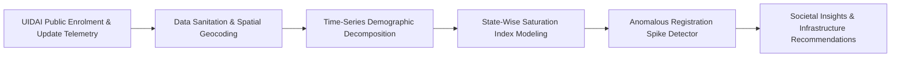

<div align="center">

  <!-- NATIVE ANIMATED CYBER BANNER -->
  

  <br/>

  <!-- ANIMATED TYPING SVG -->
  

  <br/>

  <!-- TECH BADGES -->
  <p align="center">
    
    
    
    
    
  </p>

</div>

---

### 🌟 System Overview

**Unlocking Societal Trends in Aadhaar Enrolment and Updates** is a data science research framework developed for the UIDAI Data Hackathon. It performs deep statistical analysis, anomaly detection, and spatial-temporal modeling across millions of demographic registration records to uncover societal migration trends and service access bottlenecks.

---

### 🔬 Operational Architecture & Data Pipeline Flow



---

### 🚀 Key Capabilities & Features

- **🔍 Demographic Shift Detection:** Uncovers urban migration patterns through residential address update surges.
- **📊 Saturation Analysis:** Identifies underserved rural districts lagging in biometric updates.
- **⚠️ Anomaly Spike Detection:** Flags statistical outliers in regional enrolment batches for data verification.
- **💡 Policy Recommendations:** Delivers actionable resource allocation guidelines for mobile registration centers.

---

### ⚡ Quickstart & Execution

```bash
# 1. Clone & enter
git clone https://github.com/Akshay-Notfound/UIDAI-Data-Hackathon-2026.git
cd UIDAI-Data-Hackathon-2026

# 2. Launch Jupyter Notebook
jupyter notebook
```

---

### 👤 Author & Architecture

**Akshay Shivaji Rathod**  
*Data & AI Engineer*  
* 🌐 **Portfolio:** [akshay-notfound.vercel.app](https://akshay-notfound.vercel.app)  
* 💼 **LinkedIn:** [linkedin.com/in/akshay-rathod-aaab52206](https://www.linkedin.com/in/akshay-rathod-aaab52206/)  
* 🐙 **GitHub:** [@Akshay-Notfound](https://github.com/Akshay-Notfound)  

---

<div align="center">
  <sub>Licensed under the MIT License. Designed for scalability, intelligence, and performance.</sub>
</div>
